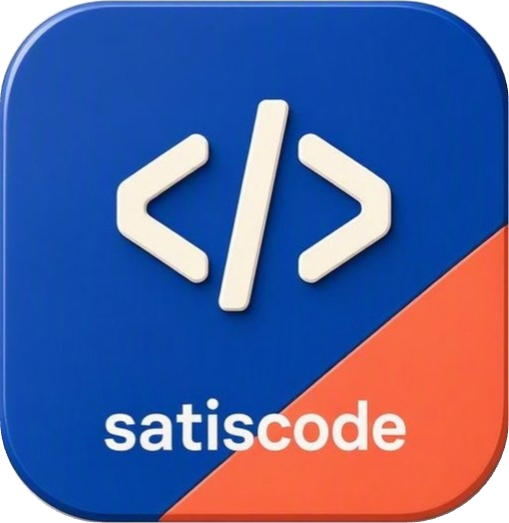

<div align="center">



# Satiscode

**A lightweight, high-performance desktop code editor for C/C++, Python, JSON, XML, and Web languages.**  
*Powered by Electron, Monaco Editor, clangd, Pyright, FIXSON, and FIXML.*

[](https://github.com/gtref/satiscode/actions/workflows/ci.yml)
[](https://github.com/gtref/satiscode/actions/workflows/codeql.yml)
[](LICENSE)
[](https://join.slack.com/t/a2-hc61499/shared_invite/zt-49ufy94zl-nTWdH_uBjDIkuPCbapoO0A)
[](https://deepwiki.com/gtref/satiscode)
[](https://alternativeto.net/software/satiscode/about/?utm_source=badge&utm_medium=referral)

[Download Installer](https://github.com/gtref/satiscode/releases/latest) • [Usage Guide](USAGE.md) • [Daily News](NEWS.md) • [Changelog](CHANGELOG.md) • [Contributing](CONTRIBUTING.md)

</div>

---

## Overview

Satiscode combines the power of Microsoft's **Monaco Editor** with deep, dedicated **Language Server Protocol (LSP)** integrations for native C/C++, Python, JSON, and XML development—without the heavy memory footprint and overhead of full IDEs.

> [!TIP]
> Try the latest web preview: [Join the beta](https://livepreview.usecartouche.com/satiscorp/)  
> Check [NEWS.md](NEWS.md) for daily development logs and ongoing task tracking.

---

## Key Features

### Language Intelligence (LSP)
- **C / C++:** Full `clangd` integration providing real-time compiler diagnostics, semantic autocomplete, symbol hover details, and go-to-definition.
- **Python:** Microsoft `pyright` type-checking, code completion, signature help, and diagnostics.
- **JSON:** Dedicated `@ronna/fixson-lsp` engine for strict syntax validation and schema hover.
- **XML:** Dedicated `@ronna/fixml-lsp` engine for XML well-formedness diagnostics, element completion, and tag inspection.
- **Web Standards:** Native Monaco syntax parsing and highlight for HTML, CSS, SCSS, JavaScript, TypeScript, and JSX/TSX.

### Editor & Workflow Experience
- **Interactive Markdown Mode:** Seamless live toggle between rendered HTML preview and raw Markdown editing.
- **Integrated Problems Panel:** VS Code-style collapsible diagnostics drawer (`Ctrl+.`) with clickable error navigation.
- **Built-in Git Version Control:** Sidebar integration for tracking file status, staging, committing, pushing, pulling, and inline Git blame.
- **File & Workspace Tree:** Fast, resizable directory Explorer with automatic folder root resolution.
- **Tabbed Interface:** Multi-buffer tab manager with unsaved change detection and protection.
- **Bilingual Interface:** Instant runtime switching between English and Spanish localizations.
- **Themes:** Dark, Light, and High Contrast themes with persistent user preferences.

---

## Language Support Matrix

| Language | Supported Extensions | LSP / Engine | Core Capabilities |
| :--- | :--- | :--- | :--- |
| **C / C++** | `.c`, `.cc`, `.cpp`, `.cxx`, `.h`, `.hh`, `.hpp`, `.hxx` | `clangd` | Diagnostics, Autocomplete, Hover, Go-to-Definition |
| **Python** | `.py` | `pyright` | Diagnostics, Completion, Hover, Go-to-Definition |
| **JSON** | `.json` | `FIXSON-LSP` | Syntax Diagnostics, Autocomplete, Hover |
| **JSONC** | `.jsonc` | Monaco Built-in | Syntax Highlight, Bracket Matching |
| **TOML** | `.toml` | Monarch Engine | Syntax Highlight, Key-Value and Table Formatting |
| **SQL / Databases** | `.sql`, `.db`, `.sqlite`, `.sqlite3` | Monaco Built-in | Full SQL syntax styling and keyword highlight |
| **XML / SVG / Plist** | `.xml`, `.xsd`, `.xsl`, `.xslt`, `.svg`, `.plist` | `FIXML-LSP` | Well-Formedness Checks, Completion, Hover |
| **Web Technologies** | `.html`, `.css`, `.scss`, `.js`, `.jsx`, `.ts`, `.tsx` | Monaco Built-in | Syntax Highlight, Smart Indent, Bracket Matching |
| **Markdown** | `.md`, `.markdown` | Custom Viewer | Live Rendered Preview, Split Editing Mode |
| **Plain Text** | All other files | Monaco Built-in | High-speed text editing buffer |

---

## System Requirements

- **Operating System:** Windows 10 or newer (64-bit).
- **Node.js:** Version 20.0 or higher *(only required for running or building from source)*.
- **Python:** Python 3.8+ required for Python language diagnostics (`pyright`).

> [!NOTE]
> Packaged Windows releases bundle `clangd` and its support libraries directly—no external LLVM installation is required for normal desktop use.

---

## Quick Start & Development

### 1. Clone & Install Dependencies
```bash
git clone https://github.com/gtref/satiscode.git
cd satiscode
npm install
```

### 2. Build Subpackages & Language Servers
```bash
npm run build
```

### 3. Launch the Application
```bash
npm start
```

> [!WARNING]
> In raw source checkouts, C/C++ diagnostics require `clangd.exe` located in `bin/` (or on your system PATH), and Python diagnostics require `pyright` in `PythonLSP/`. `npm run build` compiles the internal FIXSON and FIXML language server packages.

### 4. Build the Windows Installer
```powershell
npm run dist:win
```
The resulting executable installer is generated in `dist/`.

---

## Keyboard Shortcuts

| Shortcut | Action |
| :--- | :--- |
| `Ctrl+N` | Create new document tab |
| `Ctrl+O` | Open file picker |
| `Ctrl+K` | Open folder workspace |
| `Ctrl+S` | Save active file |
| `Ctrl+Shift+S` | Save active file as new file |
| `Ctrl+F` | Find in file |
| `Ctrl+.` | Toggle Problems panel |

---

## Project Structure

```text
satiscode/
├── main.js                  # Electron main process & OS process bridge
├── preload.js               # Context-isolated secure IPC bridge
├── index.html               # Monaco editor layout, toolbar, Explorer & Problems drawer
├── packages/
│   ├── FIXSON-LSP/          # JSON Language Server TypeScript source & build
│   └── FIXML-LSP/           # XML Language Server TypeScript source & build
├── UI/                      # Modular UI components (git sidebar, tab manager, markdown)
├── styles/                  # Application stylesheets
├── themes/                  # Theme definitions (dark, light, high-contrast)
├── icons/                   # File-type and UI icon definitions
└── docs/                    # Web IDE implementation and documentation assets
```

---

## CI/CD Architecture

Satiscode maintains automated testing, security analysis, and distribution checks using GitHub Actions:

### Automated Workflows

| Workflow | File | Triggers | Description |
| :--- | :--- | :--- | :--- |
| **CI** | `.github/workflows/ci.yml` | `push`, `pull_request` | ESLint, TypeScript compiler checks, OS-matrix test runner, asset verification |
| **CodeQL** | `.github/workflows/codeql.yml` | `push`, `pull_request`, weekly | Static security analysis for JavaScript & TypeScript |
| **Gitleaks** | `.github/workflows/gitleaks.yml` | `push`, `pull_request` | Automated secret detection across commits and PR diffs |
| **Dependency Health** | `.github/workflows/dependency-health.yml` | `push`, `pull_request`, weekly | Scans for undeclared and unused dependencies via `depcheck` |
| **Dependabot** | `.github/dependabot.yml` | Weekly | Automated dependency security and version updates |

### Local Quality Commands

Always execute the local validation suite before submitting changes:

```bash
# Run ESLint validation
npm run lint

# Run TypeScript compilation check across LSP packages
npm run typecheck

# Run test suite
npm test

# Build LSP server bundles and verify distribution assets
npm run build
npm run verify-assets

# Audit dependency health
npm run depcheck
```

---

## Repository Activity

<div align="center">

[](https://repography.com)

[](https://github.com/gtref/satiscode/commits)  
[](https://github.com/gtref/satiscode/issues)  
[](https://github.com/gtref/satiscode/pulls)  
[](https://github.com/gtref/satiscode/commits)

</div>

---

## Security Model

The editor renderer operates with `contextIsolation: true` and has no raw Node.js or child process access. All filesystem and LSP process communication is mediated through the audited preload bridge. For details or to report vulnerabilities, see [SECURITY.md](SECURITY.md).

---

## Packages

The internal Language Server Protocol implementations are also published on npm:

| Package | npm Link | Documentation |
| :--- | :--- | :--- |
| **@ronna/fixson-lsp** | [](https://www.npmjs.com/package/@ronna/fixson-lsp) | [FIXSON-LSP Guide](packages/FIXSON-LSP/README.md) |
| **@ronna/fixml-lsp** | [](https://www.npmjs.com/package/@ronna/fixml-lsp) | [FIXML-LSP Guide](packages/FIXML-LSP/README.md) |

---

## Attributions

This project utilizes software components from `clangd` (LLVM Project) and `Pyright` (Microsoft Corporation). Detailed licenses and copyright notices are documented in [NOTICES.md](NOTICES.md).

---

## Contributors

Thanks to the contributors who have helped build and improve Satiscode:

<div align="center">

| [<br><sub><b>@gtref</b></sub>](https://github.com/gtref) | [<br><sub><b>@ncs22</b></sub>](https://github.com/ncs22) | [<br><sub><b>@Igcabr01</b></sub>](https://github.com/Igcabr01) | [<br><sub><b>@ashveet</b></sub>](https://github.com/ashveet) | [<br><sub><b>@coderabbitai</b></sub>](https://github.com/apps/coderabbitai) | [<br><sub><b>@dependabot</b></sub>](https://github.com/apps/dependabot) |
| :---: | :---: | :---: | :---: | :---: | :---: |
| Project Lead | Contributor | Contributor | Contributor | Code Review Bot | Security Bot |

</div>

---

## License

Satiscode is open-source software licensed under the [MIT License](LICENSE).
